# GameForge Multi-compte Switch

**Tous tes comptes NosTale, une seule touche.**

Un petit logiciel gratuit pour Windows qui te permet de passer d'un client NosTale à l'autre avec un raccourci (par défaut la touche `²`), de garder une barre flottante discrète au-dessus du jeu et de retrouver chaque personnage d'un coup d'œil.

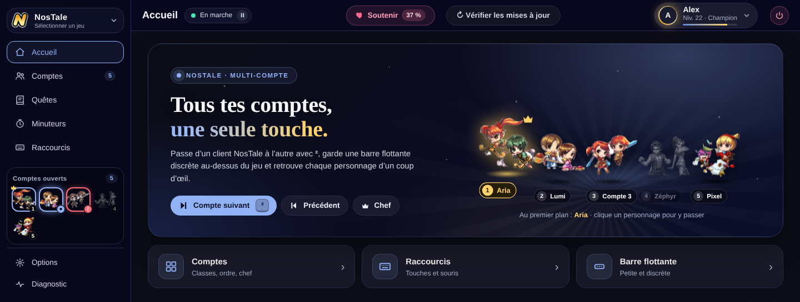

> **Ce que le logiciel ne fait jamais** : il ne joue pas à ta place. Aucun clic et aucune touche ne sont envoyés au jeu, il ne lit pas la mémoire du jeu et n'intercepte aucun paquet. Il se contente de gérer **tes fenêtres** (les mettre devant, les ranger) et d'afficher des informations. Il ne te demande **jamais** tes identifiants GameForge.

---

## Télécharger

1. Ouvre la page des [**Releases**](../../releases/latest).
2. Télécharge `GameForgeMultiCompteSwitch.exe`.
3. Lance-le : il n'y a **rien à installer**, c'est un seul fichier.

- **Windows 10 ou 11** (64 bits).
- Il utilise Microsoft Edge WebView2 pour son affichage (déjà présent sur Windows 11 et sur la plupart des Windows 10).
- Windows peut afficher un avertissement au premier lancement, car le programme n'est pas signé par un éditeur certifié. C'est normal pour un petit logiciel indépendant : choisis « Informations complémentaires » puis « Exécuter quand même ».
- Si ton jeu tourne **en administrateur**, le Switch doit l'être aussi, sinon Windows bloque les raccourcis. Une option permet de le lancer toujours en administrateur (voir [Options](#options)).

### Mises à jour

Le bouton **Vérifier les mises à jour** (en haut de la fenêtre) télécharge la nouvelle version et la remplace tout seul. Chaque mise à jour est **signée** : le programme vérifie la signature avant de l'installer et refuse un faux fichier.

---

## Visite guidée

### Choix du jeu

Au démarrage, tu choisis ton jeu. NosTale est disponible, les autres jeux GameForge sont en préparation. Tu peux changer de jeu à tout moment avec le sélecteur en haut à gauche.

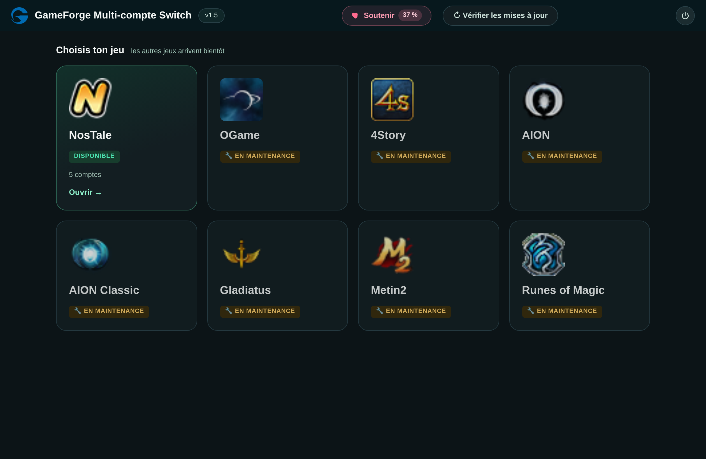

### Le menu en un coup d'œil

- **Menu de gauche** : Accueil, Comptes, Quêtes, Minuteurs et Raccourcis. **Options** et **Diagnostic** sont rangés en bas.
- **Comptes ouverts** : sous le menu, tes clients NosTale avec leur classe, leur numéro et leur couronne pour le chef. Un clic sur un compte passe dessus. Une pastille signale celui qui réclame ton attention ou qui ne répond plus.
- **Barre du haut** : l'état des raccourcis (*En marche* / *En pause*, un clic pour basculer), le bouton **Soutenir**, la mise à jour et le gros bouton **Suivant**.
- **Bas du menu** : la version, et un bouton **Admin** si le Switch doit être relancé en administrateur. Le **Diagnostic** passe en rouge quand les raccourcis ne sont pas installés.

### Accueil

Le point de départ : les gros boutons **Compte suivant**, **Précédent** et **Chef**, les actions rapides (détection, rangement des fenêtres, aperçus, overlay, lanceur GameForge, barre flottante) et tes **favoris**, c'est-à-dire des ensembles de comptes (noms, classes, équipes, disposition) que tu retrouves en un clic.

### Comptes

Tes clients NosTale apparaissent tout seuls, dans l'ordre où tu les ouvres. Le premier lancé devient le **chef**.

- Nom, classe (avec son icône) et équipe (A, B…) de chaque compte, plus une note libre.
- Changement d'ordre par glisser-déposer, activation ou désactivation d'un compte, touche dédiée par compte.
- Signalement des comptes qui **réclament ton attention** ou qui **ne répondent plus**.
- Temps de jeu du jour pour chaque compte.
- **Favoris** (ensembles de comptes) et **dispositions de fenêtres** mémorisées.

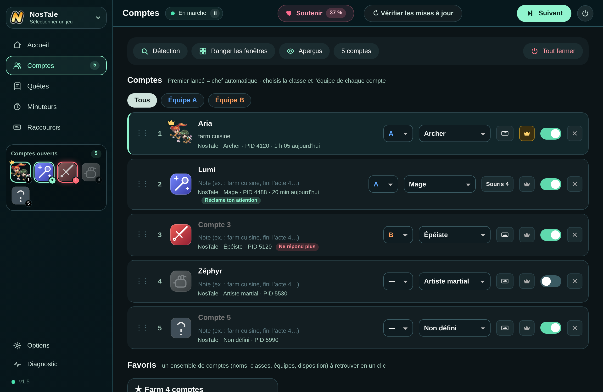

### Quêtes

Toutes les quêtes du jeu, rangées en trois catégories : **quotidiennes**, **principales** et **secondaires**. Chaque quête s'ouvre étape par étape, avec le PNJ à voir, la carte et les récompenses. Les cases se cochent compte par compte et se décochent chaque jour à l'heure de ton choix. Les données sont enregistrées sur ton PC au fur et à mesure : tu peux les consulter hors ligne.

**Quotidiennes** : la checklist du jour.

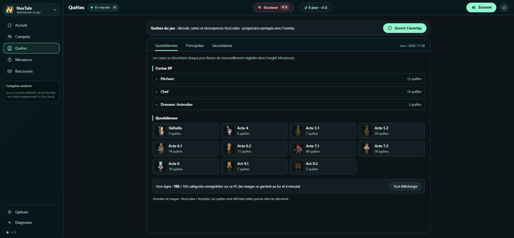

**Principales** : les actes et les quêtes de Valhalla.

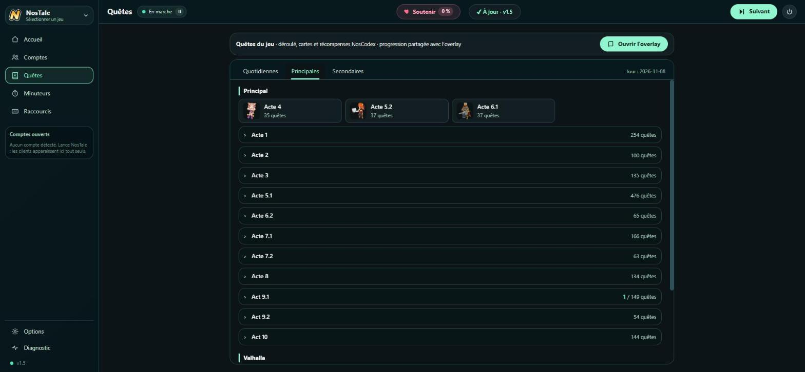

**Secondaires** : cartes SP, métiers, événements…

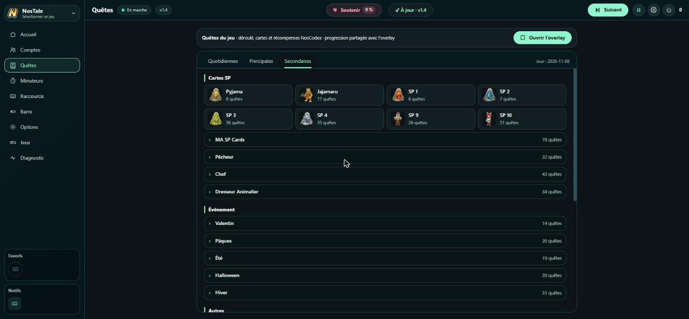

Et voici une quête ouverte, avec le PNJ et la carte :

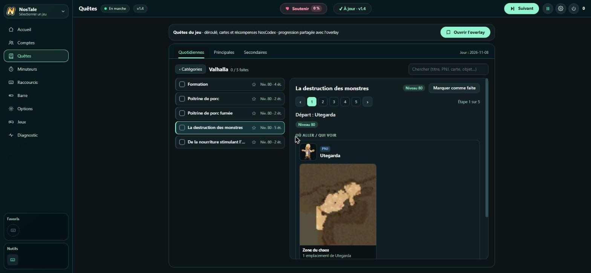

### Minuteurs

- **Minuteurs** libres (buff, récolte, pause…), avec des modèles réutilisables et des touches pour les lancer sans ouvrir la fenêtre.
- **Rappel de pause** après un certain temps de jeu.
- **Événements récurrents** du jeu (raids, arènes…) avec une alerte avant le début. Les horaires viennent de NosApki, en heure serveur.
- Heure de **renouvellement quotidien** des quêtes réglable.

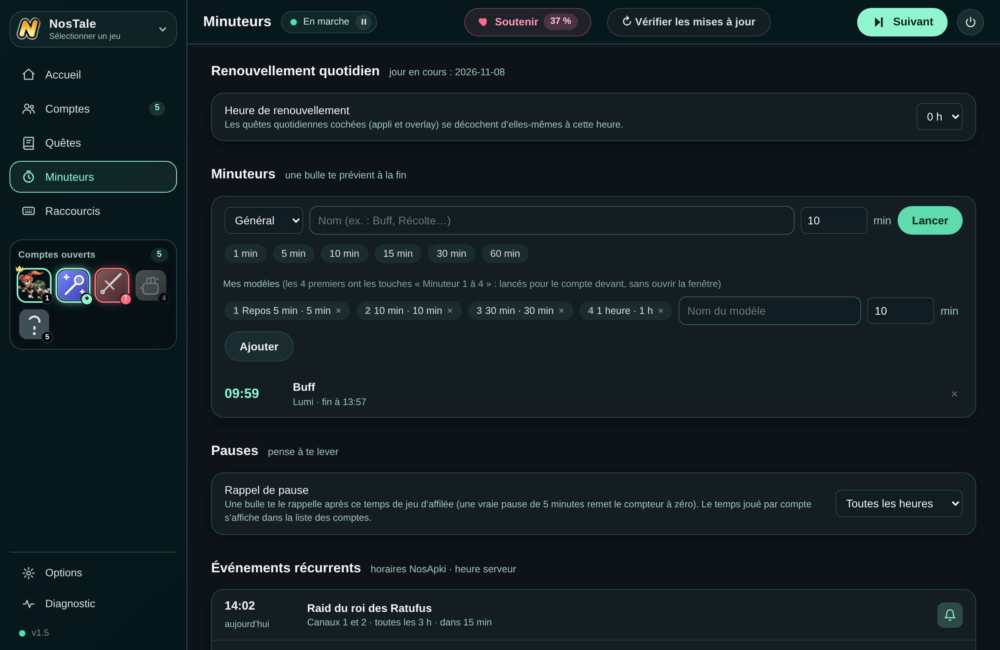

Les événements du jeu, avec le temps restant et une cloche pour être prévenu :

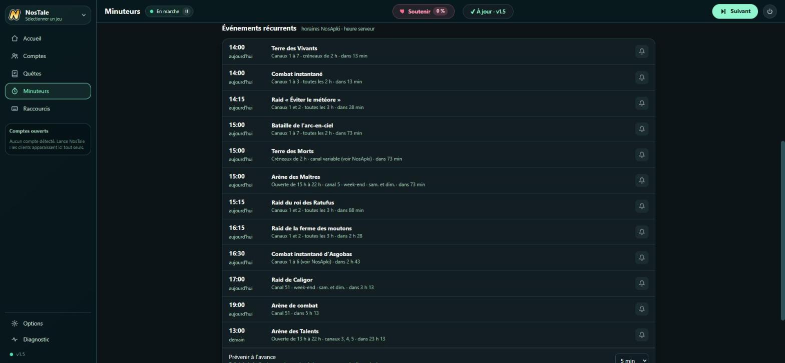

### Raccourcis

Chaque action a sa touche : clavier **ou boutons de souris**.

- Compte suivant, précédent, compte d'avant, retour au chef.
- Aller sur le compte qui appelle (celui qui clignote dans la barre des tâches).
- Changer d'équipe : la touche ne fait alors tourner que les comptes de l'équipe choisie.
- Aperçu des comptes, overlay, rangement des fenêtres, barre flottante.
- Pause et reprise de tous les raccourcis.
- Aller directement au compte n°1 à n°8.

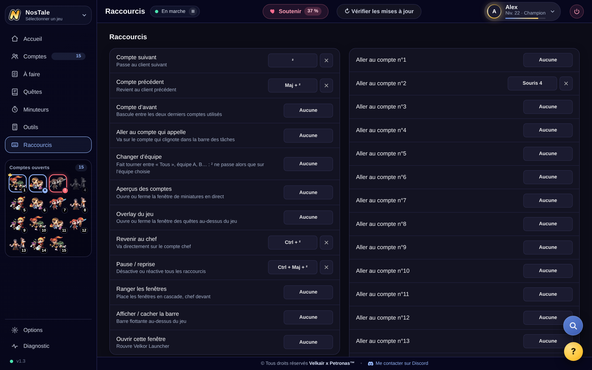

### Barre flottante

Une petite barre posée au-dessus du jeu : tes comptes avec leur classe, l'équipe, la progression des quêtes, le prochain minuteur et le prochain événement. Un clic sur un compte passe dessus. Elle peut être horizontale ou verticale, et ne s'affiche que lorsqu'un jeu est devant.

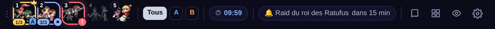

Ses réglages se trouvent dans **Options**, section *Barre flottante* :

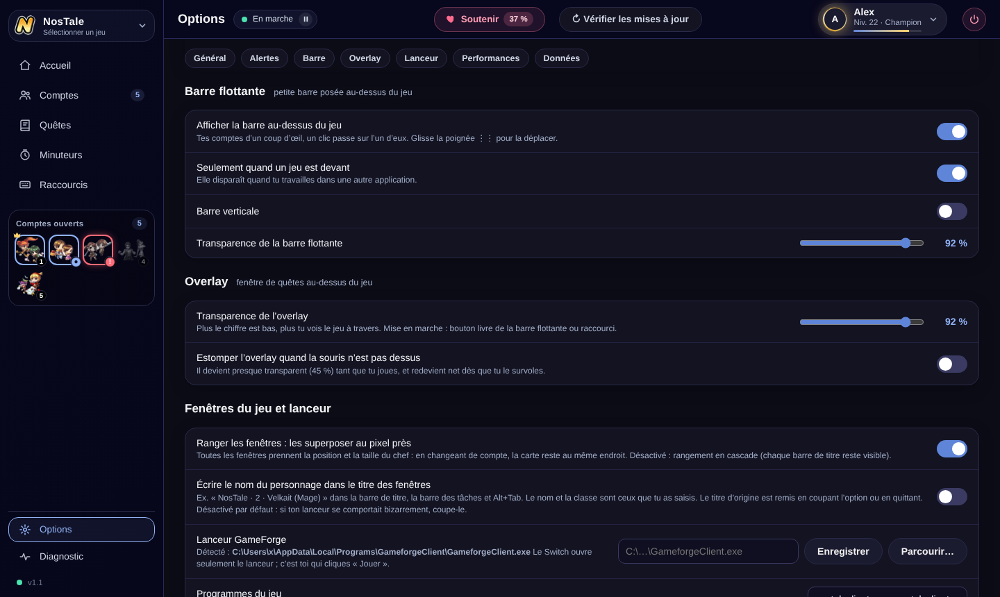

### Overlay de quêtes

Une fenêtre transparente, au-dessus du jeu, avec tes quêtes, tes guides et le minuteur. Sa transparence se règle, et elle s'estompe quand la souris n'est pas dessus pour ne jamais gêner.

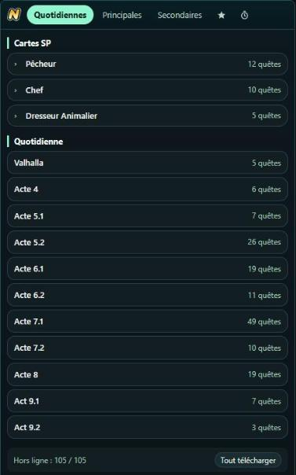

### Options

Les réglages sont rangés par sections, avec des boutons en haut de la page pour aller directement à celle qu'on cherche.

- **Général** : langue de l'interface (français, anglais, espagnol ou allemand), **Démarrer avec Windows**, **Toujours lancer en administrateur**, et le comportement de la fenêtre quand on la ferme (le Switch reste actif dans la zone de notification).
- **Raccourcis et alertes** : raccourcis actifs **seulement quand un jeu est devant** (tes touches restent normales dans Discord, le navigateur…), bulles quand un compte réclame l'attention ou qu'un client ne répond plus, petit son.
- **Barre flottante** et **Overlay** : affichage, barre verticale, transparence, estompage de l'overlay quand la souris n'est pas dessus.
- **Fenêtres du jeu et lanceur** : nom du personnage dans le titre des fenêtres, chemin du lanceur GameForge, noms des programmes du jeu.
- **Économie de ressources** : couper le son ou baisser la priorité des comptes inactifs (désactivé par défaut).
- **Données et sauvegarde** : icônes personnalisées et **sauvegarde de la configuration** (export et import).

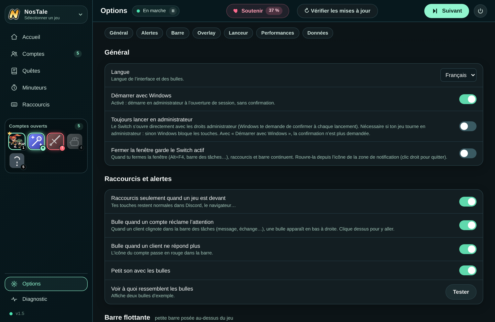

### Diagnostic

Si quelque chose ne marche pas : l'état des raccourcis, des droits et des fenêtres vues, l'accès au journal, et un bouton qui **copie un rapport** à coller dans un message pour demander de l'aide. Le rapport est anonymisé.

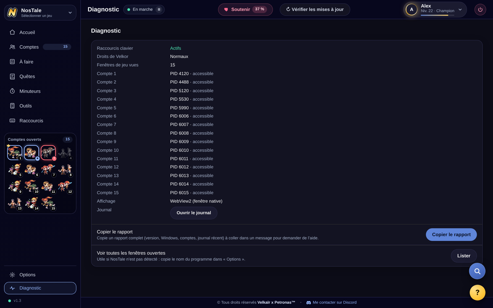

### Soutenir

Tout reste **gratuit et rien n'est bloqué**. Le bouton **Soutenir** ouvre la jauge du mois : les dons financent le temps passé à améliorer le logiciel. La jauge repart à zéro le 1er de chaque mois, et les soutiens du mois sont remerciés.

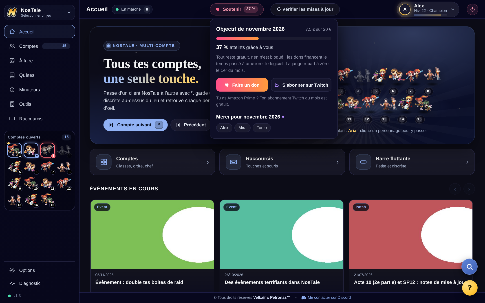

---

## Questions fréquentes

**Est-ce autorisé par le jeu ?**
Le logiciel ne touche pas au jeu : il ne simule aucune action et ne lit rien dans le client. Il agit uniquement sur les fenêtres Windows, comme le ferait un Alt+Tab amélioré. Il n'est cependant pas officiel et chacun reste responsable de son usage.

**Mes identifiants GameForge sont-ils utilisés ?**
Non. Le logiciel ne les demande, ne les lit et ne les stocke jamais.

**Où sont enregistrés mes réglages ?**
Sur ton PC, dans ton dossier utilisateur. Rien n'est envoyé à un serveur, à part la vérification des mises à jour (et de la jauge de soutien) sur GitHub.

**Un raccourci ne répond pas.**
Vérifie que le Switch et le jeu ont les mêmes droits (tous les deux en administrateur, ou aucun des deux), puis ouvre l'onglet **Diagnostic**.

---

## Avertissement

Logiciel indépendant et non officiel, sans lien avec GameForge, Entwell ou les éditeurs des jeux cités. NosTale, GameForge et les autres noms et logos appartiennent à leurs propriétaires respectifs. Les données de quêtes et d'horaires proviennent de NosCodex et de NosApki.
