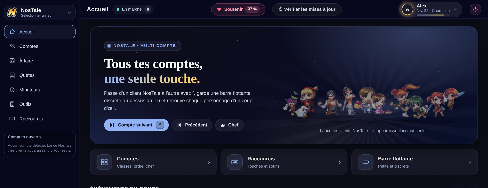
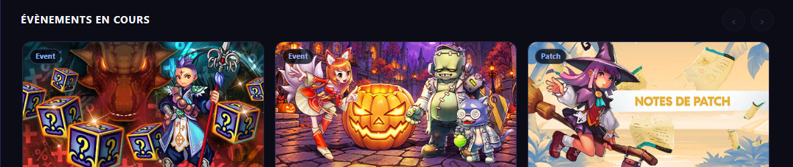
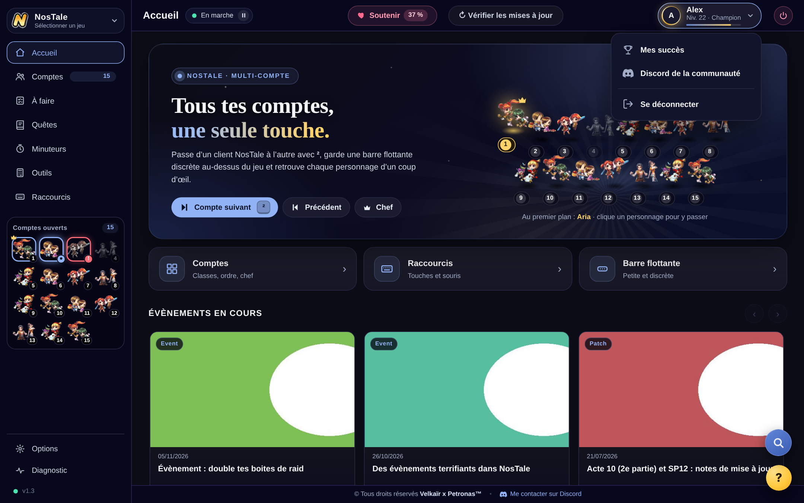
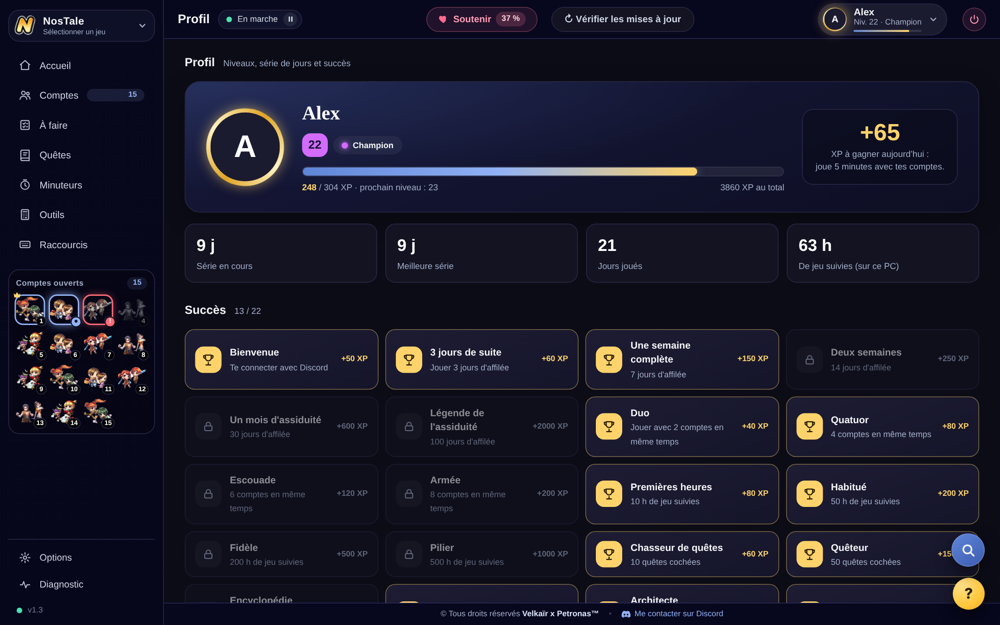
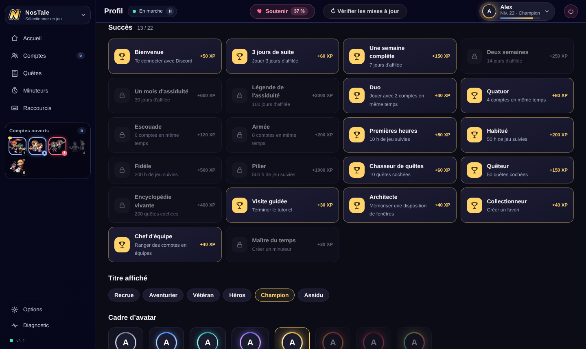

# GameForge Multi-compte Switch

**Tous tes comptes NosTale, une seule touche.**

Un petit logiciel gratuit pour Windows qui te permet de passer d'un client NosTale à l'autre avec un raccourci (par défaut la touche `²`), de garder une barre flottante discrète au-dessus du jeu et de retrouver chaque personnage d'un coup d'œil.

> **Ce que le logiciel ne fait jamais** : il ne joue pas à ta place. Aucun clic et aucune touche ne sont envoyés au jeu, il ne lit pas la mémoire du jeu et n'intercepte aucun paquet. Il se contente de gérer **tes fenêtres** (les mettre devant, les ranger) et d'afficher des informations. Il ne te demande **jamais** tes identifiants GameForge.

**Sommaire** : [Télécharger](#télécharger) · [Visite guidée](#visite-guidée) · [Niveaux et profil Discord](#niveaux-et-profil-discord-facultatif) · [Communauté](#communauté) · [Questions fréquentes](#questions-fréquentes)

---

## Télécharger

1. Ouvre la page des [**Releases**](../../releases/latest).
2. Télécharge `GameForgeMultiCompteSwitch.exe`.
3. Lance-le : il n'y a **rien à installer**, c'est un seul fichier.

- **Windows 10 ou 11** (64 bits).
- Il utilise Microsoft Edge WebView2 pour son affichage (déjà présent sur Windows 11 et sur la plupart des Windows 10).
- Windows peut afficher un avertissement au premier lancement, car le programme n'est pas signé par un éditeur certifié. C'est normal pour un petit logiciel indépendant : choisis « Informations complémentaires » puis « Exécuter quand même ».
- Si ton jeu tourne **en administrateur**, le Switch doit l'être aussi, sinon Windows bloque les raccourcis. Une option permet de le lancer toujours en administrateur (voir [Options](#options)).
- L'interface existe en **français, anglais, espagnol et allemand**.

### Mises à jour

Le bouton **Vérifier les mises à jour** (en haut de la fenêtre) télécharge la nouvelle version et la remplace tout seul. Chaque mise à jour est **signée** : le programme vérifie la signature avant de l'installer et refuse un faux fichier.

---

## Visite guidée

### Choix du jeu

Au démarrage, tu choisis ton jeu. **NosTale** est disponible ; les autres jeux GameForge (OGame, 4Story, AION, AION Classic, Gladiatus, Metin2, Runes of Magic) sont affichés en maintenance, en attendant leur tour. Tu peux changer de jeu à tout moment avec le sélecteur en haut à gauche.

### L'interface en un coup d'œil

- **Menu de gauche** : Accueil, Comptes, Quêtes, Minuteurs et Raccourcis. **Options** et **Diagnostic** sont rangés en bas, avec le numéro de version.
- **Comptes ouverts** : sous le menu, tes clients NosTale avec leur classe, leur numéro et leur couronne pour le chef. Un clic sur un compte passe dessus. Une pastille signale celui qui réclame ton attention ou qui ne répond plus.
- **Barre du haut** :
  - l'état des raccourcis (*En marche* / *En pause*, un clic pour basculer) ;
  - le bouton **Soutenir** ;
  - **Vérifier les mises à jour** ;
  - ta **pastille de profil** (voir [Niveaux et profil Discord](#niveaux-et-profil-discord-facultatif)) ;
  - le bouton rond **éteindre**, qui ferme le Switch.
- Le **Diagnostic** passe en rouge quand les raccourcis ne sont pas installés, et un bouton **Admin** apparaît si le Switch doit être relancé en administrateur.

### Accueil

Le point de départ. En haut, tes personnages sont alignés avec leur classe et leur numéro, le chef porte la couronne et le personnage au premier plan est mis en avant : un clic sur l'un d'eux passe dessus. Dessous, les gros boutons **Compte suivant**, **Précédent** et **Chef**, puis trois accès rapides vers les comptes, les raccourcis et la barre flottante.

Quand aucun client n'est ouvert, l'Accueil t'invite à les lancer : ils apparaîtront tout seuls.

Plus bas, **Évènements en cours** : les actualités, évènements et notes de mise à jour du jeu, avec leurs images officielles. Un clic ouvre l'article dans ton navigateur. Les actualités sont simplement lues sur le site de GameForge, rien n'est envoyé.

### Comptes

Tes clients NosTale apparaissent tout seuls, dans l'ordre où tu les ouvres. Le premier lancé devient le **chef**.

- En haut de la page : **Détection**, **Ranger les fenêtres**, **Aperçus**, **Barre flottante** (activée ou non) et **Tout fermer** (avec confirmation) pour fermer tous les clients d'un coup.
- Nom, classe (avec son icône) et équipe (A, B…) de chaque compte, plus une note libre.
- Des onglets **Tous / Équipe A / Équipe B** pour ne voir qu'une équipe.
- Changement d'ordre par glisser-déposer, activation ou désactivation d'un compte, touche dédiée par compte (clavier ou souris).
- Signalement des comptes qui **réclament ton attention** ou qui **ne répondent plus**.
- Temps de jeu du jour pour chaque compte.
- **Favoris** (ensembles de comptes) et **dispositions de fenêtres** mémorisées.

### Quêtes

Toutes les quêtes du jeu, rangées en trois catégories : **quotidiennes**, **principales** et **secondaires**. Chaque quête s'ouvre étape par étape, avec le PNJ à voir, la carte et les récompenses. Les cases se cochent compte par compte et se décochent chaque jour à l'heure de ton choix. Les données sont enregistrées sur ton PC au fur et à mesure : tu peux les consulter hors ligne. Le bouton **Ouvrir l'overlay** affiche tes quêtes au-dessus du jeu.

- **Quotidiennes** : la checklist du jour.
- **Principales** : les actes et les quêtes de Valhalla.
- **Secondaires** : cartes SP, métiers, événements…

### Minuteurs

- **Minuteurs** libres (buff, récolte, pause…), avec des modèles réutilisables et des touches pour les lancer sans ouvrir la fenêtre.
- **Rappel de pause** après un certain temps de jeu.
- **Événements récurrents** du jeu (raids, arènes…) avec une alerte avant le début. Les horaires viennent de NosApki, en heure serveur.
- Heure de **renouvellement quotidien** des quêtes réglable.

Les événements du jeu, avec le temps restant et une cloche pour être prévenu :

### Raccourcis

Chaque action a sa touche : clavier **ou boutons de souris**.

- Compte suivant, précédent, compte d'avant, retour au chef.
- Aller sur le compte qui appelle (celui qui clignote dans la barre des tâches).
- Changer d'équipe : la touche ne fait alors tourner que les comptes de l'équipe choisie.
- Aperçu des comptes, overlay, rangement des fenêtres, barre flottante.
- Pause et reprise de tous les raccourcis.
- Aller directement au compte n°1 à n°8.

### Barre flottante

Une petite barre posée au-dessus du jeu : tes comptes avec leur classe, l'équipe, la progression des quêtes, le prochain minuteur et le prochain événement. Un clic sur un compte passe dessus. Elle peut être horizontale ou verticale, et ne s'affiche que lorsqu'un jeu est devant.

Ses réglages se trouvent dans **Options**, section *Barre flottante* :

### Overlay de quêtes

Une fenêtre transparente, au-dessus du jeu, avec tes quêtes, tes guides et le minuteur. Sa transparence se règle, et elle s'estompe quand la souris n'est pas dessus pour ne jamais gêner.

### Options

Les réglages sont rangés par sections, avec des boutons en haut de la page (Général, Alertes, Barre, Overlay, Lanceur, Performances, Données) pour aller directement à celle qu'on cherche.

- **Général** : langue de l'interface (français, anglais, espagnol ou allemand), **Démarrer avec Windows**, **Toujours lancer en administrateur**, et le comportement de la fenêtre quand on la ferme (le Switch reste actif dans la zone de notification).
- **Alertes** : raccourcis actifs **seulement quand un jeu est devant** (tes touches restent normales dans Discord, le navigateur…), bulles quand un compte réclame l'attention ou qu'un client ne répond plus, petit son.
- **Barre flottante** et **Overlay** : affichage, barre verticale, transparence, estompage de l'overlay quand la souris n'est pas dessus.
- **Lanceur** : superposition des fenêtres au pixel près, nom du personnage dans le titre des fenêtres, chemin du lanceur GameForge, noms des programmes du jeu.
- **Performances** : couper le son ou baisser la priorité des comptes inactifs (désactivé par défaut).
- **Données** : icônes personnalisées et **sauvegarde de la configuration** (export et import).

### Diagnostic

Si quelque chose ne marche pas : l'état des raccourcis, des droits et des fenêtres vues, l'accès au journal, et un bouton qui **copie un rapport** à coller dans un message pour demander de l'aide. Le rapport est anonymisé.

### Soutenir

Tout reste **gratuit et rien n'est bloqué**. Le bouton **Soutenir** ouvre la jauge du mois : les dons financent le temps passé à améliorer le logiciel. La jauge repart à zéro le 1er de chaque mois, et les soutiens du mois sont remerciés.

---

## Niveaux et profil Discord (facultatif)

Tu peux te connecter avec Discord pour gagner de l'XP en utilisant le Switch. **C'est entièrement facultatif** : sans connexion, tout le reste du logiciel fonctionne pareil.

- **De l'XP chaque jour joué** : joue au moins 5 minutes avec tes comptes, et la **série de jours d'affilée** fait grimper le gain du jour.
- **50 niveaux, 8 rangs**, de Recrue à Mythique.
- **22 succès** : Duo, Quatuor, Armée, une semaine ou un mois d'assiduité, premières heures de jeu, quêtes cochées, premier favori, première disposition…
- **Titres et cadres d'avatar** à débloquer et à afficher à côté de ton pseudo.
- **Ton rang devient un rôle** sur le serveur Discord de la communauté.

Ta **pastille de profil** en haut à droite affiche ton pseudo, ton niveau, ton rang et ta progression. Son menu donne accès à **Mes succès**, au **Discord de la communauté** et à **Se déconnecter**.

La page **Profil** montre ton niveau, ta série, tes jours joués et tes heures de jeu suivies, puis tous tes succès :

Les succès, les titres et les cadres d'avatar :

**Ce qui est enregistré, et rien d'autre** : ton pseudo et ton avatar Discord, ta série de jours, et quelques compteurs de progression (nombre de comptes ouverts en même temps, heures de jeu suivies, nombre de quêtes cochées…). Rien du jeu, aucun identifiant GameForge, aucun nom de personnage. Un bouton **Supprimer mon profil** efface tout, définitivement, quand tu veux.

---

## Communauté

Un serveur Discord réunit les utilisateurs : aide sur le logiciel, nouveautés de chaque version, suggestions, signalement de bugs, discussion par jeu (NosTale et les autres jeux GameForge), évènements et concours.

**[Rejoindre le Discord](https://discord.gg/esKBUCrK22)**

- **Accueil** : règles, annonces, choix de tes jeux, de ta classe et de tes notifications en cliquant sur des boutons.
- **Launcher** : guide de démarrage, nouveautés, aide, bugs, suggestions et passages de niveau.
- **Communauté** : discussion, captures, recherche de groupe, vidéos et streams, et un salon pour les anglophones.
- **Un coin par jeu**, et des salons **évènements et concours**.

Le serveur est animé par des joueurs et n'est pas affilié à GameForge.

---

## Questions fréquentes

**Est-ce autorisé par le jeu ?**
Le logiciel ne touche pas au jeu : il ne simule aucune action et ne lit rien dans le client. Il agit uniquement sur les fenêtres Windows, comme le ferait un Alt+Tab amélioré. Il n'est cependant pas officiel et chacun reste responsable de son usage.

**Mes identifiants GameForge sont-ils utilisés ?**
Non. Le logiciel ne les demande, ne les lit et ne les stocke jamais.

**Où sont enregistrés mes réglages ?**
Sur ton PC, dans ton dossier utilisateur.

**À quels sites le logiciel se connecte-t-il ?**
- **GitHub** : vérification des mises à jour et jauge de soutien.
- **Le site de GameForge** : les actualités du jeu de l'Accueil, en lecture seule.
- **NosCodex et NosApki** : les quêtes et les horaires des évènements.
- **Le serveur de niveaux de la communauté** : uniquement si tu te connectes avec Discord, et seulement avec ce qui est décrit dans [Niveaux et profil Discord](#niveaux-et-profil-discord-facultatif).

**Dois-je me connecter avec Discord ?**
Non. Les niveaux, les succès et les rôles sont un bonus. Tu peux te connecter, te déconnecter (menu de la pastille en haut à droite) ou supprimer ton profil (bouton en bas de la page **Profil**) à tout moment.

**Un raccourci ne répond pas.**
Vérifie que le Switch et le jeu ont les mêmes droits (tous les deux en administrateur, ou aucun des deux), puis ouvre l'onglet **Diagnostic**.

**Comment je demande de l'aide ou je signale un bug ?**
Sur le [serveur Discord](https://discord.gg/esKBUCrK22), dans les salons d'aide et de bugs. Colle le rapport copié depuis l'onglet **Diagnostic** pour aller plus vite.

---

## Avertissement

Logiciel indépendant et non officiel, sans lien avec GameForge, Entwell ou les éditeurs des jeux cités. NosTale, GameForge et les autres noms et logos appartiennent à leurs propriétaires respectifs. Les données de quêtes et d'horaires proviennent de NosCodex et de NosApki.
